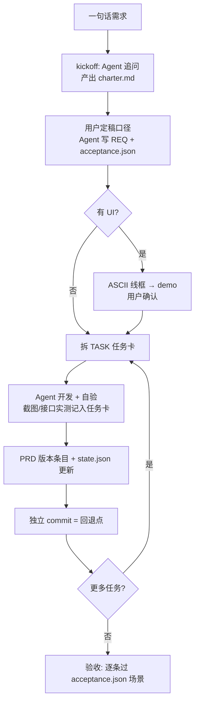

# Sandwich Dev（三明治开发法）

> **你只做定稿人，Agent 承包其余一切，git 留下每一步证据。**
> You make the calls. The agent does the rest. Every step leaves a git breadcrumb.

一套给 AI Agent 用的产品研发工作流（agent skill），适用于 Claude Code / CatPaw 等文件驱动型编码 Agent。

## 它解决什么问题

用 Agent 做产品，常见两种失控：

1. **Agent 全自主跑** —— 快是快，但口径它替你拍了、验收标准它自己定，做完你发现"这不是我要的东西"，且改起来无从下手；
2. **每步都问你** —— 你变成了人肉审批机，一个登录页问 8 个问题，最后你比 Agent 还累。

Sandwich Dev 是第三条路：**三层三明治**。

```
┌─────────────────────────────────────────────────┐
│ 定稿层（人类）                                    │
│   只做决策：拍口径、选方案、定验收标准、控优先级      │
├─────────────────────────────────────────────────┤
│ 规格层（Agent 产出，人类可随时翻阅/修改/补充）       │
│   REQ 文档 + 验收场景 / ASCII 线框 / UI demo       │
│   TASK 任务卡 / PRD 版本账本 / state.json 状态机    │
├─────────────────────────────────────────────────┤
│ 执行层（Agent 自主）                               │
│   编码 / 自验（截图+接口实测）/ 版本号 / commit     │
└─────────────────────────────────────────────────┘
```

中层把"用户的意图"翻译成"可验收的规格"，上层的每次拍板都**留痕**在 REQ 文档里，下层的每次交付都**有版本号可回退**。

## 核心机制

**1. 文件驱动，一切落地为 Markdown/JSON**

```
docs/
├── charter.md                  # 项目章程（kickoff 追问的产物）
├── PRD.md                      # Changelog 倒序，每个版本一段完整记录
├── state.json                  # 项目状态机（任务状态/checkpoint/历史）
├── reqs/
│   ├── REQ-012-实体级GEO.md    # 需求：背景 + 已定稿口径 + 数据模型 + ASCII 线框
│   └── REQ-012.acceptance.json # 验收：S1~Sn 场景（when/then）
└── tasks/
    └── TASK-025-xxx.md         # 任务卡：实现范围 + 自验记录 + 备注
```

**2. git 证据链：REQ → TASK → commit**

每个任务完成即独立 commit（commit message 关联 REQ 与 PRD 版本号）。**版本号 = 回退单位**——任何一个 commit 都能 `git reset` 回去，任何一段 PRD 条目都能查到"当时为什么这么做"。

**3. 定稿必留痕**

用户在多个方案中的选择（如"三选一选了 A，成本线性增长已知悉"）原样写进 REQ 的「已定稿口径」一节。三个月后没人记得为什么这么做时，答案在文档里，不在聊天记录里。

**4. 免确认流水线（可选授权）**

用户说一句"都做了吧，每完成一项记录版本号，我能回退就可以"，Agent 即获得批量授权：按计划逐项执行，每项独立 commit 作为回退点。**信任通过可回退性换取，而不是通过逐步审批换取。**

**5. UI 先 ASCII 线框，后实现**

线框是定稿层和执行层之间最便宜的沟通货币——30 秒画完，改 3 遍不心疼，确认后才写代码。

**6. 竞品逆向叠加（REA）**

做功能前先逆向竞品的真实实现（接口结构 / 交互流 / 数据模型），洞察直接变成 REQ 的输入。逆向不是抄——是站在对手的施工图上画自己的图，并找出对手没有的层。详见 [SKILL.md 流程第 2 步](SKILL.md)。

> 完整故事与动机（vibecoding 的随机性、东修西补的混沌、可见即可得）见 **[ANNOUNCEMENT.md](ANNOUNCEMENT.md)**。

## 快速开始

方式 A —— 作为 agent skill 安装（CatPaw / Claude Code）：

```bash
# 把本仓库（或其 SKILL.md + templates/）放入技能目录
cp -r sandwich-dev ~/.claude/skills/   # Claude Code
# CatPaw 用户放到 ~/.catpaw/skills/
```

然后对 Agent 说：**"用三明治开发法启动一个新项目：……（一句话需求）"**

方式 B —— 手动初始化项目骨架：

```bash
node scripts/init.mjs ./my-new-product
# 生成 docs/ 全套骨架（charter / PRD / state.json / reqs / tasks）
```

## 工作流全景



## 适合谁

- 独立开发者 / 小团队，想用 Agent 做真实产品（不是玩具 demo）；
- 被两种极端坑过的人：全放手失控了，全审批累死了；
- 需求方是"决策者"而非"执行者"：你出判断，Agent 出劳力。

## 实战战绩

本范式在真实 SaaS 项目（品牌 AI 可见性优化平台，含 LLM 多引擎采样、异步流水线、多云部署）中完整跑通 25+ 任务、13 个 REQ，从 kickoff 到阿里云公网上线，全程无一行代码由人类手写，每个功能可追溯到 REQ 文档与验收场景。

## License

MIT
